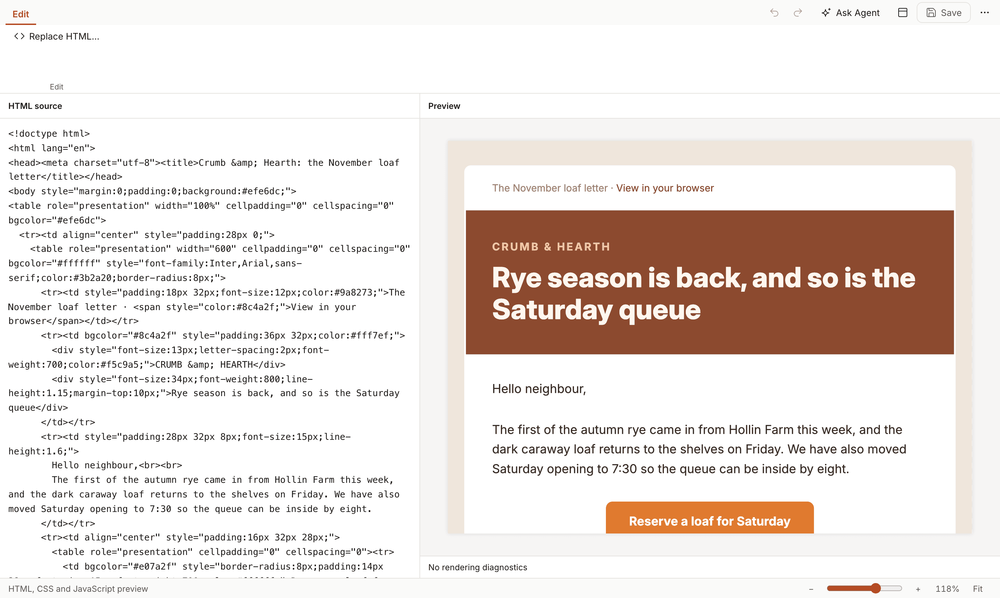
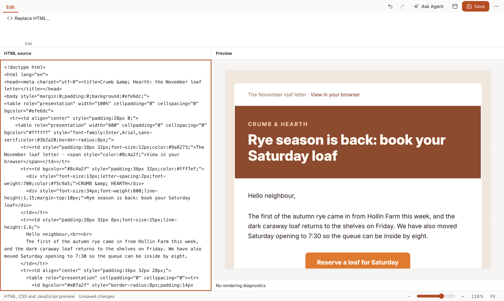
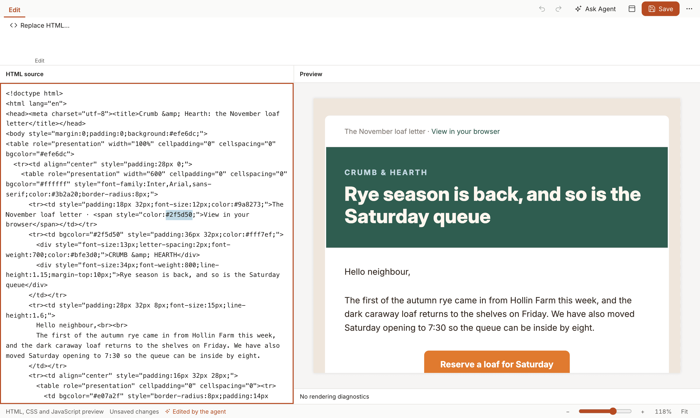
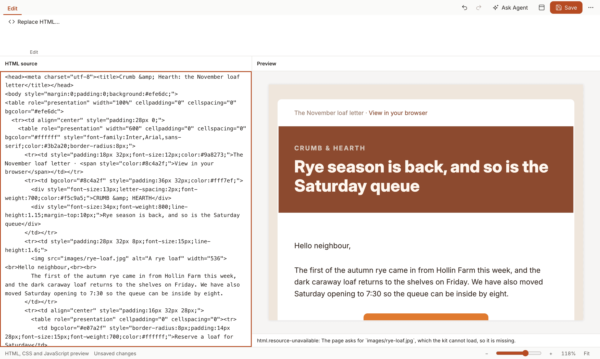
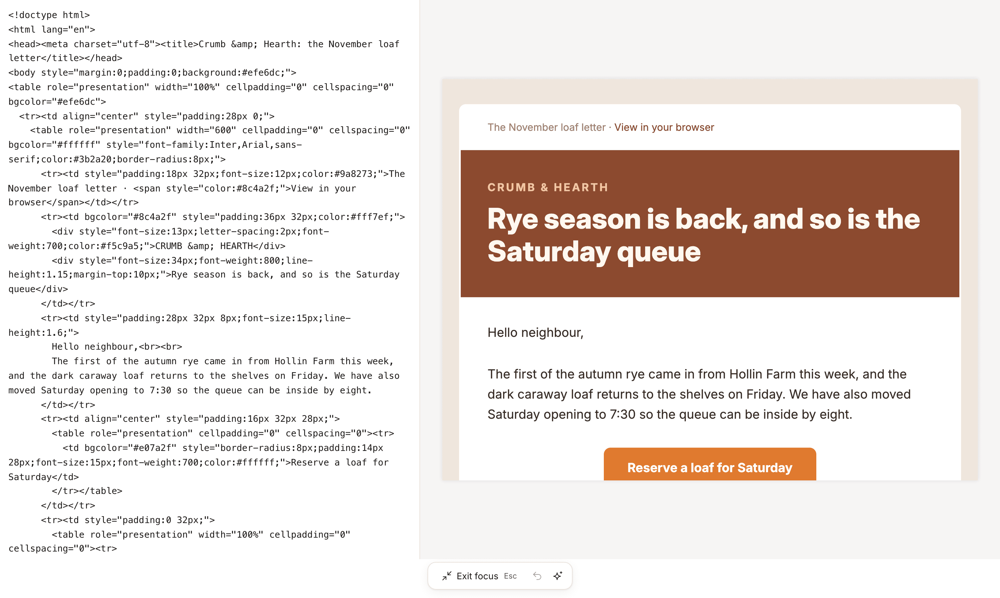
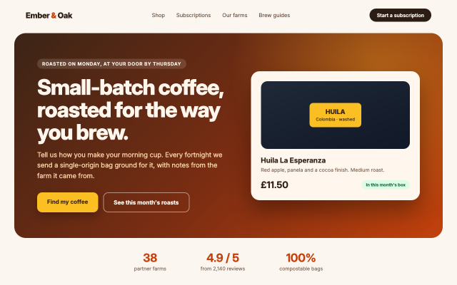
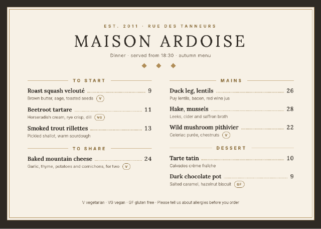
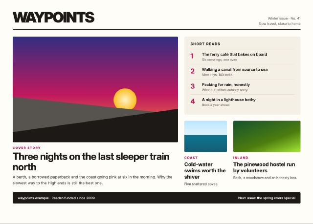
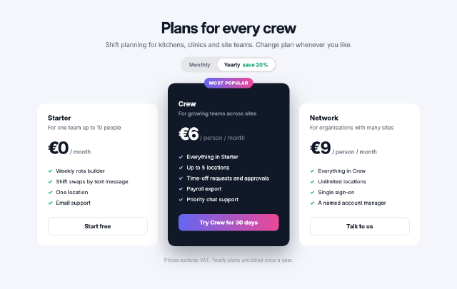

<div align="center">

# Kition HTML

**Kition HTML: an editor and live preview for HTML pages, for people and AI agents**

Source and live preview · A check for what won't load · Undo per person · Focus mode · MCP tools for agents

[](LICENSE)
[](https://www.npmjs.com/package/@kition/embed)
[](https://github.com/kitharness/kitharness)
[](crates/kition-html-kit)

[Use it in Kition](https://kition.ai) · [Embed it](#embed-it-in-your-app) · [Give it to your agent](#give-it-to-your-agent) · [Showcase](https://github.com/KitionAI/kition-showcase/tree/main/html) · [Developer docs](https://developer.kition.ai) · [KHP](https://github.com/kitharness/kitharness)

</div>

An HTML page is text, but you rarely get to see the text and the page at once. A page builder
hides the source. A text editor shows only the source. An AI agent can write HTML, but it can't
tell whether the page it wrote draws, or whether it asks for a file that isn't there.

Kition HTML puts the page's source beside a live preview, drawn by the kit's own Rust engine. You
type in the source, and the preview and the check follow. An AI agent edits the same file with the
same command, runs the same check, and fixes what it reports. When it edits a page you have open,
you see the change arrive.



## What it does

### Why HTML

- **The source and the page, side by side.** Type in the source and the preview redraws. The file
  is saved as the text you wrote, nothing more.
- **A check that says what is missing.** It names each file the page links that the kit can't
  load, and each script error with where it happened.
- **Built for agents.** An agent reads the source, writes the new page in one step, checks it and
  fixes what the check found. Its edits to a page you have open show up live.
- **Undo that knows who did what.** Each change is one undo step, and your undo takes back your
  changes, not the agent's.
- **Nothing leaves the page.** The preview fetches nothing from the network or the disk, so a page
  can't reach out while you work on it.
- **Its own renderer, open source.** The preview is drawn by a Rust engine compiled to WebAssembly
  and run in a Web Worker. Apache-2.0, engine and editor.

### See it

<table>
<tr>
<td width="50%"><br /><b>Edit the source</b>: type, and the preview redraws the page.</td>
<td width="50%"><br /><b>Agent edits, live</b>: an agent changes the open page, and the editor says so.</td>
</tr>
<tr>
<td width="50%"><br /><b>The check</b>: what the page asks for and can't get is named under the preview.</td>
<td width="50%"><br /><b>Focus</b>: only the source and the preview.</td>
</tr>
</table>

### Made with HTML

<table>
<tr>
<td width="25%"><a href="https://github.com/KitionAI/kition-showcase/tree/main/html/coffee-roaster-landing-hero"></a></td>
<td width="25%"><a href="https://github.com/KitionAI/kition-showcase/tree/main/html/bistro-dinner-menu"></a></td>
<td width="25%"><a href="https://github.com/KitionAI/kition-showcase/tree/main/html/travel-magazine-grid"></a></td>
<td width="25%"><a href="https://github.com/KitionAI/kition-showcase/tree/main/html/team-plan-pricing-cards"></a></td>
</tr>
</table>

Every sample is built with HTML's own commands. [See all of them](https://github.com/KitionAI/kition-showcase/tree/main/html).

### Formats

| Opens | Creates | Exports |
| --- | --- | --- |
| `.html`, `.htm` | `.html` | — |

A page is its source text. Editing means changing that text: in the editor you type in the source,
and an agent replaces the whole source with the `file.setSource` command, one undo step each time.
The file is saved as that text.

## Quick start

### Use it in Kition

Open a `.html` or `.htm` file in Kition and it opens in this editor. Kition's agent edits the same
file with the kit's `html_*` tools. [Download Kition](https://github.com/KitionAI/kition/releases/latest).

### Embed it in your app

HTML's editor is a static package you host yourself, mounted into your page with the Kition SDK's
[`@kition/embed`](https://www.npmjs.com/package/@kition/embed). You keep the files and the users;
the editor reads and writes through the functions you give it.

1. Download `kition-html-<version>.tgz` from the
   [latest release](https://github.com/KitionAI/kition-html/releases/latest) and serve its
   `html-ui/` folder as static files on its own origin, with the headers in the
   [embed reference](https://github.com/KitionAI/kition-sdk/blob/main/docs/platform/reference/embed.md).
2. Install the SDK and mount the editor:

```sh
npm install @kition/embed
```

```ts
import { KitionEmbed } from '@kition/embed'

const editor = await KitionEmbed.mount(document.getElementById('page')!, {
  kit: { id: 'kit.html', url: 'https://kits.example.com/html-ui/' }, // the package you host
  file: { id: 'newsletter', name: 'Newsletter.html' },
  storage: {
    read: async (id) => api.read(id),                    // { bytes, version }
    write: async (id, bytes, { expectedVersion }) =>     // refuse a stale version
      api.write(id, bytes, expectedVersion),             // { version }
  },
})
```

Every save carries the version it read, so an edit made elsewhere is never written over. The
[embed guide](https://github.com/KitionAI/kition-sdk/blob/main/docs/sdk/embed.md) covers identity,
checks and the rest.

### Give it to your agent

The engine also runs headless, and `kition`, the Kition SDK's command line, serves it as MCP tools
(`html_inspect`, `html_run`, `html_check`, ...) on a folder of pages, for any MCP client. Nothing
is compiled: you need neither Rust nor the Kition app. Install `kition`, then connect your agent
in the folder:

```sh
npm install -g @kition/cli        # Node.js 20 or later; gives the kition command
kition agent add claude           # or codex, cursor: registers kition's MCP server
```

Without installing it:
`claude mcp add kition -- npx -y @kition/cli mcp --workspace "$PWD"`. Without Node.js, install
`kition` with `curl -fsSL https://github.com/KitionAI/kition-sdk/releases/latest/download/install.sh | sh`
(Windows: `irm https://github.com/KitionAI/kition-sdk/releases/latest/download/install.ps1 | iex`)
and run the same `kition agent add`.

`kition` holds no kit. The first time the agent opens a `.html` file, through the `kit_inspect`
tool the server offers until HTML is installed, `kition` downloads HTML's headless executable
into `~/.kition/kits` and the html tools appear. `kition kit install html` downloads it ahead of
time, and `kition kit upgrade` moves it to the newest version. Claude Desktop, Cursor, Codex and
the other commands are in the SDK's
[agent guide](https://github.com/KitionAI/kition-sdk/blob/main/docs/sdk/agent.md#connect-your-agent)
and [`kition` guide](https://github.com/KitionAI/kition-sdk/blob/main/docs/sdk/cli.md). To run
a build of your own (working on the kit itself), see
[docs/development.md](docs/development.md#the-headless-executable-and-mcp).

A real session on a copy of the newsletter sample, abridged. The agent changes the headline and
adds a picture, the check finds that the picture can't load, and the agent draws one instead:

```text
> html_inspect {"path":"newsletter.html"}
Opened `newsletter.html`: 640 × 480
{…,"details":{…,"source":"<!doctype html>\n<html lang=\"en\">\n<head><meta charset=\"utf-8\">
  <title>Crumb &amp; Hearth: the November loaf letter</title></head>…"},…,"revision":"vpu0",…}

> html_run {"path":"newsletter.html","basis":"vpu0","steps":[{"command":"file.setSource","params":{"source":
    "<!doctype html>…Rye season is back: book your Saturday loaf…
     <br>Hello neighbour,…"}}]}
Ran 1 commands on `newsletter.html` (saved): 640 × 480 Changes: objects 1 changed; 1 new diagnostic(s), 0 resolved.

> html_check {"path":"newsletter.html"}
Checked `newsletter.html`: 1 error, no warnings, no notes.
{"diagnostics":[{"code":"html.resource-unavailable","message":"The page asks for `images/rye-loaf.jpg`,
  which the kit cannot load, so it is missing.","severity":"error","target":{}}]}

> html_run {"path":"newsletter.html","basis":"vpu1","steps":[{"command":"file.setSource","params":{"source":
    "<!doctype html>…<svg width=\"536\" height=\"120\" role=\"img\" aria-label=\"A rye loaf\">…</svg>
     <br>Hello neighbour,…"}}]}
Ran 1 commands on `newsletter.html` (saved): 640 × 480 Changes: objects 1 changed; 0 new diagnostic(s), 1 resolved.

> html_check {"path":"newsletter.html"}
Checked `newsletter.html`: the kit found nothing wrong.
```

Every write names the revision it read (`basis`), and each answer says what changed and which
diagnostics are new or resolved. The agent's guide is [agent/guide.md](agent/guide.md).

## Maturity

Preview: early, expect gaps. Version 0.1.3 · KHP 1.0, conformance level `basic`.

| Works today | Partly there | Not yet |
| --- | --- | --- |
| Editing the page's source, with undo and redo | Clicking the preview and moving its clock to run the page's scripts | Loading linked images, style sheets and scripts: write them into the page |
| A live preview drawn by the kit's engine | Looking exactly as in a browser: 76 of 128 test pages match | Choosing the preview's page size: pages are laid out 640 pixels wide |
| A check for missing files and script errors | The browser APIs scripts can use | Editing on the preview itself: you edit the source |
| Agents that edit, check and fix a page | Form controls: date, number and color inputs, select lists | Exporting to other formats |

Known gaps: [docs/gaps.md](docs/gaps.md). What's next: [docs/roadmap.md](docs/roadmap.md).

## Build and contribute

Build and test instructions are in [docs/development.md](docs/development.md). Read
[CONTRIBUTING.md](.github/CONTRIBUTING.md) before opening a pull request, and ask questions in
[Discussions](https://github.com/KitionAI/kition/discussions) or on [Discord](https://discord.gg/bFSjRDjVY).

<!-- kition-family:begin (generated by kition-sdk from templates/community/repositories.json, its family; edit the data there, not this text) -->
## The Kition family

Kition is the open pro suite for AI: 16 kits, editors that people and AI agents use on the same files, and the products around them ([all repositories](https://github.com/KitionAI)).

| Product | What it is | Links |
| --- | --- | --- |
| Kition Desktop | The open pro suite for AI: 16 editors and an agent in one desktop app | [GitHub](https://github.com/KitionAI/kition) · [kition.ai](https://kition.ai) |
| Kition SDK | Put Kition's editors in your product, and give the same files to your AI agent | [GitHub](https://github.com/KitionAI/kition-sdk) · [developer.kition.ai](https://developer.kition.ai) |
| `kition` command line | Install kits on demand and run them for your agent: `npx @kition/cli` | [developer.kition.ai](https://developer.kition.ai) · [Guide](https://github.com/KitionAI/kition-sdk/blob/main/docs/sdk/cli.md) |
| Kition One | A self-hosted team workspace built on Kition's kits | [one.kition.ai](https://one.kition.ai) |
| Kition Server | Real-time co-editing for kits, self-hosted | [developer.kition.ai](https://developer.kition.ai) |
| Kit Harness Protocol (KHP) | The open protocol between a kit and its host | [GitHub](https://github.com/kitharness/kitharness) · [kitharness.org](https://kitharness.org) |
| Kition Tessera | The design system for kits | [GitHub](https://github.com/KitionAI/kition-tessera) · [tessera.kition.ai](https://tessera.kition.ai) |
| Kition Showcase | Sample files for every kit | [GitHub](https://github.com/KitionAI/kition-showcase) |
| Kition Universe | A 3D map of the kits and what they make | [GitHub](https://github.com/KitionAI/kition-universe) · [universe.kition.ai](https://universe.kition.ai) |
| Kition Fonts | The open fonts the editors use | [GitHub](https://github.com/KitionAI/kition-fonts) |

| Product line | Kits |
| --- | --- |
| Office | [Note](https://github.com/KitionAI/kition-note) · [Table](https://github.com/KitionAI/kition-table) · [Board](https://github.com/KitionAI/kition-board) · [Doc](https://github.com/KitionAI/kition-doc) · [Sheet](https://github.com/KitionAI/kition-sheet) · [Slide](https://github.com/KitionAI/kition-slide) · [PDF](https://github.com/KitionAI/kition-pdf) · **HTML** (Preview) |
| Design | [Photo](https://github.com/KitionAI/kition-photo) · [Vector](https://github.com/KitionAI/kition-vector) · [Layout](https://github.com/KitionAI/kition-layout) · [Design](https://github.com/KitionAI/kition-design) (Preview) |
| Media | [Film](https://github.com/KitionAI/kition-film) · [Motion](https://github.com/KitionAI/kition-motion) |
| Engineering | [CAD](https://github.com/KitionAI/kition-cad) · [Scene](https://github.com/KitionAI/kition-scene) (Preview) |
<!-- kition-family:end -->

## License

Apache-2.0 ([LICENSE](LICENSE)). Third-party licenses and notices are listed in [NOTICE](NOTICE),
which names the included projects; [docs/attribution.md](docs/attribution.md) lists the vendored
code and assets with their licenses.
